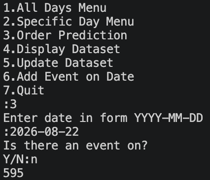
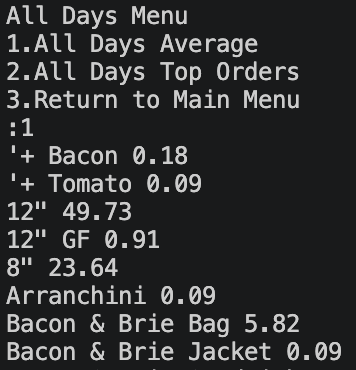
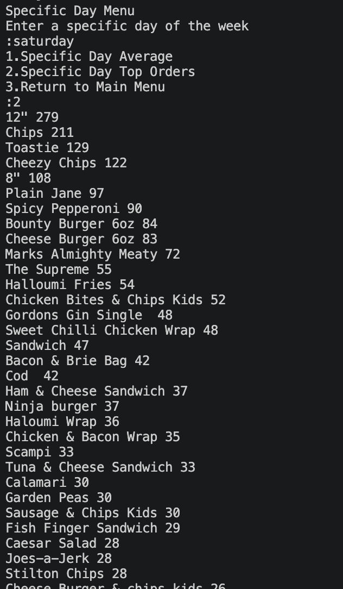

# Order Prediction Software
A python application that analyses past order counts, weather, day of week and special event dates to predict the number of orders on a given date.
The application also provides tools for analysing average orders and top orders for all time and specific days of the week.

<p align="centre">



</p>

## About  
This project was made for my local pub/restaurant that I am a cook at and also to further my understanding of data processing, API use and machine learning in python.
The application takes historical daily sales data, retrieves the weather for that date from Open-Meteo API combines them into a dataset to train a Random Forest Regression model.
The model can then be used to predict the number of orders on a given date after fetching the weather forecast for that date.

## Features 
### Sales Analysis
* Calculates average orders over all time  
* Calculates average orders for a specific day of the week
* Displays top orders of all time
* Filters out unwanted items
* Automatically processes multiple CSV files

### Weather Data 
* Uses Open-Meteo API
* Retrieves historical forecast data for model training
* Retrieves future forecast for predicting order count
* Handles failed API requests

### Order Prediction 
* Uses Random Forest Regression model
* Predicts order count for a given data  
* Uses day of week, month, max temperature, rainfall and event days in calculation
* 

## Architecture 

## Build
```  

```
